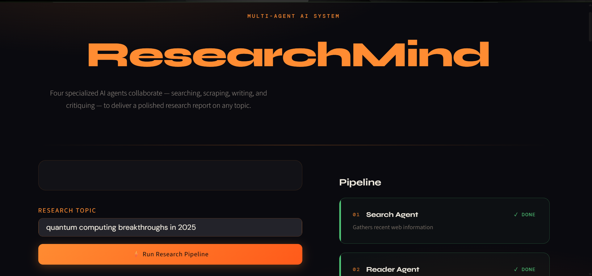
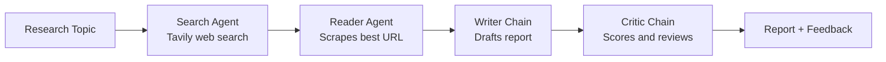

# 🔬 ResearchMind: Multi-Agent AI Research System

> Enter a topic. Four specialized AI agents search the web, read the best source, write a structured report and critique it, all in one click.

ResearchMind is a multi-agent research assistant built with **LangChain**, **Google Gemini**, **Tavily** and **Streamlit**. A tool-using *Search Agent* and *Reader Agent* gather information, then a *Writer Chain* and a *Critic Chain* turn it into a polished report with a score and feedback. It runs as a web app or from the command line.

<p align="center">
  
</p>

---

## 📑 Table of Contents

- [Features](#-features)
- [How It Works](#-how-it-works)
- [Tech Stack](#-tech-stack)
- [Project Structure](#-project-structure)
- [Getting Started](#-getting-started)
- [Running the Project](#-running-the-project)
- [Configuration](#-configuration)
- [Example Output](#-example-output)
- [Troubleshooting](#-troubleshooting)
- [Limitations](#-limitations)
- [Roadmap](#-roadmap)
- [Contributing](#-contributing)
- [Author](#-author)

---

## ✨ Features

- **Four-stage multi-agent pipeline:** search, read, write and critique, each with a single clear responsibility
- **Tool-using agents:** the Search Agent calls Tavily for live web results, and the Reader Agent scrapes a chosen page for deeper content
- **Structured reports:** Introduction, Key Findings (at least 3 points), Conclusion and Sources
- **Built-in critic:** every report gets a score out of 10, strengths, areas to improve and a one-line verdict
- **Live pipeline view:** status cards show each stage as waiting, running or done
- **Download the report** as a Markdown file with one click
- **Inspect raw outputs:** expand the Search and Reader results to see what the agents actually found
- **Two interfaces:** a Streamlit web UI (`app.py`) and a terminal version (`pipeline.py`)
- **Custom dark UI** with example topics to try

---

## 🧠 How It Works



| Step | Component | Type | What it does |
|------|-----------|------|--------------|
| 01 | **Search Agent** | Agent + `web_search` tool | Queries Tavily (up to 5 results) and returns titles, URLs and snippets |
| 02 | **Reader Agent** | Agent + `scrape_url` tool | Picks the most relevant URL from the search results and scrapes its text (first 3,000 characters) |
| 03 | **Writer Chain** | Prompt, LLM and output parser | Combines search results and scraped content into a structured report |
| 04 | **Critic Chain** | Prompt, LLM and output parser | Reviews the report and returns a score, strengths, improvements and a verdict |

All four stages use the same Gemini model, configured once in `agents.py`.

**Agents vs. chains:** the Search and Reader stages are *agents* because the model decides when and how to call a tool. The Writer and Critic stages are simple *chains* (`prompt | llm | StrOutputParser()`) because they only transform text.

---

## 🛠️ Tech Stack

| Layer | Technology |
|-------|-----------|
| Language | Python 3.10+ |
| LLM | Google Gemini via `langchain-google-genai` |
| Agent framework | LangChain (`create_agent`, prompt templates, output parsers) |
| Web search | [Tavily](https://tavily.com/) |
| Web scraping | `requests` and `BeautifulSoup4` |
| Web UI | [Streamlit](https://streamlit.io/) |
| Config | `python-dotenv` |

---

## 📁 Project Structure

```
.
├── app.py              # Streamlit web UI and pipeline orchestration
├── agents.py           # LLM setup, Search/Reader agents, Writer/Critic chains
├── tools.py            # web_search (Tavily) and scrape_url tools
├── pipeline.py         # Command-line version of the full pipeline
├── check_models.py     # Utility: lists Gemini models available to your API key
├── requirements.txt    # Python dependencies
├── .streamlit/
│   └── config.toml     # (optional) dark theme settings
├── .env                # API keys, not committed to Git
└── README.md
```

---

## 🚀 Getting Started

### Prerequisites

- Python **3.10 or higher**
- A **Google Gemini API key**: get one from [Google AI Studio](https://aistudio.google.com/)
- A **Tavily API key**: get one from [tavily.com](https://tavily.com/) (a free tier is available)

### 1. Clone the repository

```bash
git clone https://github.com/kolleparavarshith/Multi-Agent-AI-Research-System.git
cd Multi-Agent-AI-Research-System
```

### 2. Create and activate a virtual environment

```bash
python -m venv .venv

# Windows
.venv\Scripts\activate

# macOS / Linux
source .venv/bin/activate
```

### 3. Install dependencies

```bash
pip install -r requirements.txt
```

### 4. Set up your API keys

Create a file named `.env` in the project root:

```env
GOOGLE_API_KEY=your_gemini_api_key_here
TAVILY_API_KEY=your_tavily_api_key_here
```

> ⚠️ Never commit your `.env` file. Make sure it is listed in `.gitignore`.

### 5. (Optional) Enable the dark theme

Create `.streamlit/config.toml`:

```toml
[theme]
base = "dark"
backgroundColor = "#0a0a0f"
textColor = "#e8e4dc"
primaryColor = "#ff8c32"
```

---

## ▶️ Running the Project

### Web app (recommended)

```bash
streamlit run app.py
```

Open the URL shown in the terminal (usually http://localhost:8501), then:

1. Type a research topic, for example `Quantum computing breakthroughs in 2025`
2. Click **⚡ Run Research Pipeline**
3. Watch the four pipeline cards update as each stage finishes
4. Read the report and the critic's feedback, and download the report as `.md`

### Command line

```bash
python pipeline.py
```

You'll be prompted for a topic, and each stage's output is printed to the terminal.

### Check which Gemini models you can use

```bash
python check_models.py
```

This prints the model names available to your API key. It is useful when you get a "model not found" error or want to switch models.

---

## ⚙️ Configuration

| What | Where | Details |
|------|-------|---------|
| Gemini model | `agents.py` | Change the `model=` value in `ChatGoogleGenerativeAI(...)` |
| Temperature | `agents.py` | Set to `0` for consistent, factual output |
| Number of search results | `tools.py` | `max_results=5` in `tavily.search(...)` |
| Snippet length | `tools.py` | `r['content'][:300]` |
| Scraped text length | `tools.py` | `[:3000]` characters per page |
| Search text passed to the Reader | `app.py`, `pipeline.py` | `[:800]` characters |
| Report structure | `agents.py` | Edit `writer_prompt` |
| Critic format | `agents.py` | Edit `critic_prompt` |

---

## 📄 Example Output

**Final report** (Markdown):

```
# Research Report: <Topic>

## Introduction
...
## Key Findings
1. ...
2. ...
3. ...
## Conclusion
...
## Sources
- https://...
```

**Critic feedback:**

```
Score: 8/10

Strengths:
- ...

Areas to Improve:
- ...

One line verdict:
...
```

---

## 🩺 Troubleshooting

**`429 RESOURCE_EXHAUSTED` / quota exceeded**
The Gemini free tier limits the number of requests per day for each model. One pipeline run makes several LLM calls (the agents may call the model more than once each). Wait for the daily reset, switch to a different model in `agents.py`, use an API key from another Google Cloud project, or enable billing.

**`404 model not found`**
The model name in `agents.py` isn't available for your key. Run `python check_models.py` and copy a valid model name.

**`ImportError: cannot import name 'create_agent'`**
`create_agent` is available in LangChain 1.x. Upgrade with `pip install -U langchain langchain-google-genai`.

**Tavily authentication error or `None` API key**
Check that `TAVILY_API_KEY` is set in your `.env` and that you run the app from the project root so `load_dotenv()` finds the file.

**`Could not scrape URL: ...` in the Reader output**
Some sites block scrapers, require JavaScript or time out. The pipeline continues using the search results, but the report may be less detailed.

**Text or input box not visible in the UI**
Create the `.streamlit/config.toml` shown above, restart Streamlit and hard-refresh the browser (Ctrl+Shift+R).

---

## ⚠️ Limitations

- The Reader Agent scrapes **one** page per run, so depth depends on the page it picks
- Scraping uses plain `requests`, so JavaScript-rendered pages and sites that block bots may return little or no text
- Report quality depends on the sources found; the Critic reviews the writing but does not fact-check against the web
- Free-tier API quotas limit how many runs you can do per day
- The report may contain errors, so verify important claims against the cited sources

---

## 🗺️ Roadmap

- [ ] Let the Reader Agent scrape multiple URLs
- [ ] Stream each agent's output live in the UI
- [ ] Add a revision loop where the Writer improves the report using the Critic's feedback
- [ ] Choose the model from the UI
- [ ] Export the report as PDF
- [ ] Add response caching to save API calls
- [ ] Add tests and CI

---

## 🤝 Contributing

Contributions are welcome.

1. Fork the repository
2. Create a branch: `git checkout -b feature/your-feature`
3. Commit your changes: `git commit -m "Add your feature"`
4. Push to the branch: `git push origin feature/your-feature`
5. Open a Pull Request

---

## 👤 Author

**Kollepara Naga Sri Lakshmi Varshith**
GitHub: [@kolleparavarshith](https://github.com/kolleparavarshith)

---

<p align="center">Built with LangChain · Gemini · Tavily · Streamlit</p>